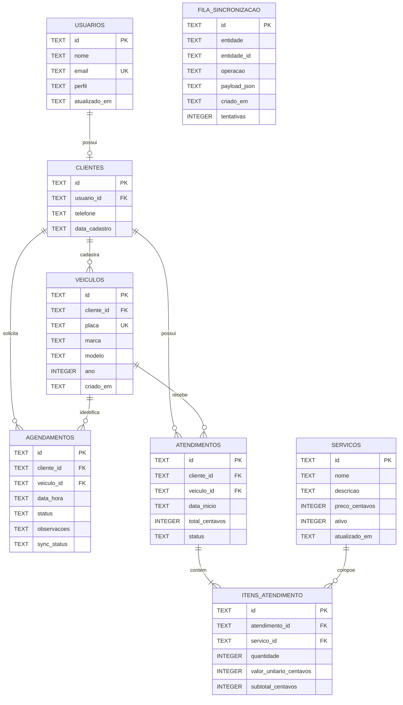

# 5. Modelo entidade-relacionamento do banco de dados local

O banco local do S&R Auto utilizará SQLite. Os identificadores serão armazenados como `TEXT` no formato UUID. Datas e horários serão armazenados como texto no padrão ISO-8601. Valores monetários serão armazenados como números inteiros em centavos.

## 5.1 Entidades, colunas, tipos e restrições

### USUARIOS

| Coluna | Tipo SQLite | Restrições |
|---|---|---|
| id | TEXT | PRIMARY KEY, NOT NULL |
| nome | TEXT | NOT NULL |
| email | TEXT | NOT NULL, UNIQUE |
| perfil | TEXT | NOT NULL, CHECK (perfil IN ('cliente','admin')) |
| atualizado_em | TEXT | NOT NULL |

### CLIENTES

| Coluna | Tipo SQLite | Restrições |
|---|---|---|
| id | TEXT | PRIMARY KEY, NOT NULL |
| usuario_id | TEXT | NOT NULL, UNIQUE, FOREIGN KEY → USUARIOS(id) |
| telefone | TEXT | NOT NULL |
| data_cadastro | TEXT | NOT NULL |

### VEICULOS

| Coluna | Tipo SQLite | Restrições |
|---|---|---|
| id | TEXT | PRIMARY KEY, NOT NULL |
| cliente_id | TEXT | NOT NULL, FOREIGN KEY → CLIENTES(id) |
| placa | TEXT | NOT NULL, UNIQUE |
| marca | TEXT | NOT NULL |
| modelo | TEXT | NOT NULL |
| ano | INTEGER | CHECK (ano IS NULL OR ano BETWEEN 1950 AND 2100) |
| criado_em | TEXT | NOT NULL |

### SERVICOS

| Coluna | Tipo SQLite | Restrições |
|---|---|---|
| id | TEXT | PRIMARY KEY, NOT NULL |
| nome | TEXT | NOT NULL |
| descricao | TEXT | NOT NULL |
| preco_centavos | INTEGER | NOT NULL, CHECK (preco_centavos >= 0) |
| ativo | INTEGER | NOT NULL, CHECK (ativo IN (0,1)) |
| atualizado_em | TEXT | NOT NULL |

### AGENDAMENTOS

| Coluna | Tipo SQLite | Restrições |
|---|---|---|
| id | TEXT | PRIMARY KEY, NOT NULL |
| cliente_id | TEXT | NOT NULL, FOREIGN KEY → CLIENTES(id) |
| veiculo_id | TEXT | NOT NULL, FOREIGN KEY → VEICULOS(id) |
| data_hora | TEXT | NOT NULL, formato ISO-8601 |
| status | TEXT | NOT NULL, CHECK (status IN ('pendente','confirmado','cancelado','concluido')) |
| observacoes | TEXT | NOT NULL, valor padrão vazio |
| sync_status | TEXT | NOT NULL, CHECK (sync_status IN ('pendente','sincronizado','erro')) |

### ATENDIMENTOS

| Coluna | Tipo SQLite | Restrições |
|---|---|---|
| id | TEXT | PRIMARY KEY, NOT NULL |
| cliente_id | TEXT | NOT NULL, FOREIGN KEY → CLIENTES(id) |
| veiculo_id | TEXT | NOT NULL, FOREIGN KEY → VEICULOS(id) |
| data_inicio | TEXT | NOT NULL, formato ISO-8601 |
| total_centavos | INTEGER | NOT NULL, CHECK (total_centavos >= 0) |
| status | TEXT | NOT NULL, CHECK (status IN ('aberto','em_andamento','concluido','cancelado')) |

### ITENS_ATENDIMENTO

| Coluna | Tipo SQLite | Restrições |
|---|---|---|
| id | TEXT | PRIMARY KEY, NOT NULL |
| atendimento_id | TEXT | NOT NULL, FOREIGN KEY → ATENDIMENTOS(id) |
| servico_id | TEXT | NOT NULL, FOREIGN KEY → SERVICOS(id) |
| quantidade | INTEGER | NOT NULL, CHECK (quantidade > 0) |
| valor_unitario_centavos | INTEGER | NOT NULL, CHECK (valor_unitario_centavos >= 0) |
| subtotal_centavos | INTEGER | NOT NULL, CHECK (subtotal_centavos >= 0) |

### FILA_SINCRONIZACAO

| Coluna | Tipo SQLite | Restrições |
|---|---|---|
| id | TEXT | PRIMARY KEY, NOT NULL |
| entidade | TEXT | NOT NULL |
| entidade_id | TEXT | NOT NULL |
| operacao | TEXT | NOT NULL, CHECK (operacao IN ('criar','atualizar','excluir')) |
| payload_json | TEXT | NOT NULL |
| criado_em | TEXT | NOT NULL, formato ISO-8601 |
| tentativas | INTEGER | NOT NULL DEFAULT 0, CHECK (tentativas >= 0) |

## 5.2 Relacionamentos

| Relação | Cardinalidade | Regra de negócio |
|---|---|---|
| USUARIOS → CLIENTES | 1 : 0..1 | Um usuário de perfil cliente pode possuir um cadastro de cliente. |
| CLIENTES → VEICULOS | 1 : N | Um cliente pode cadastrar vários veículos; cada veículo pertence a um cliente. |
| CLIENTES → AGENDAMENTOS | 1 : N | Um cliente pode solicitar vários agendamentos. |
| VEICULOS → AGENDAMENTOS | 1 : N | Um veículo pode estar associado a vários agendamentos. |
| CLIENTES → ATENDIMENTOS | 1 : N | Um cliente pode possuir vários atendimentos. |
| VEICULOS → ATENDIMENTOS | 1 : N | Um veículo pode possuir vários atendimentos. |
| ATENDIMENTOS → ITENS_ATENDIMENTO | 1 : N | Um atendimento pode conter vários itens de serviço. |
| SERVICOS → ITENS_ATENDIMENTO | 1 : N | Um serviço pode aparecer em vários itens de atendimento. |

## 5.3 Diagrama entidade-relacionamento

## 5.4 Regras de integridade e observações

- Todas as tabelas possuem chave primária.
- As chaves estrangeiras garantem que os registros relacionados existam.
- O aplicativo deverá habilitar `PRAGMA foreign_keys = ON` em cada conexão SQLite.
- E-mails e placas serão únicos após normalização.
- Campos obrigatórios utilizarão `NOT NULL`.
- Valores e quantidades terão restrições `CHECK`.
- Valores monetários serão armazenados em centavos (`INTEGER`), evitando imprecisão de ponto flutuante.
- A aplicação e a API também deverão validar se o veículo selecionado pertence ao cliente informado em agendamentos e atendimentos, pois as duas chaves estrangeiras isoladas não garantem essa correspondência.
- A tabela FILA_SINCRONIZACAO mantém operações pendentes para envio posterior à API; ela não substitui as entidades de negócio.
